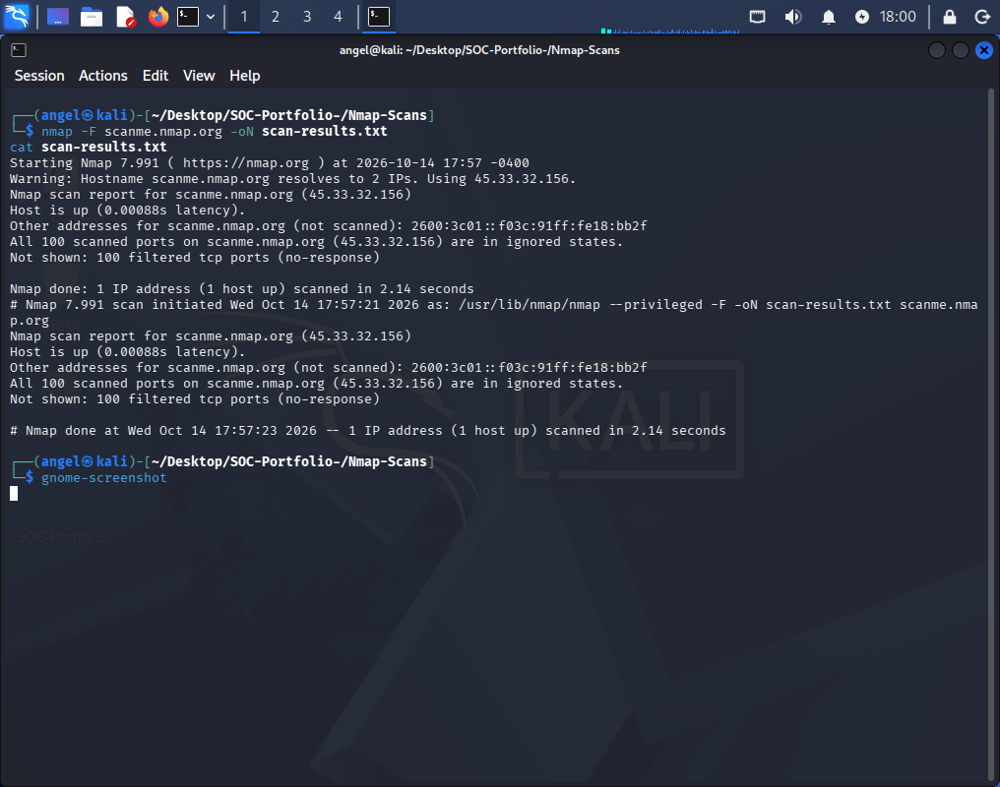

# Nmap Scan - scanme.nmap.org

## Objective
Perform authorized perimeter scan.

## Command
nmap -F scanme.nmap.org

## Findings
- Host: 45.33.32.156 - All 100 ports filtered (firewall present)
- Host up, no open ports

## Evidence - My Nmap Screenshot

See scan-results.txt for full output.

## SOC Lesson
Filtered ports = firewall is working. No action needed.
