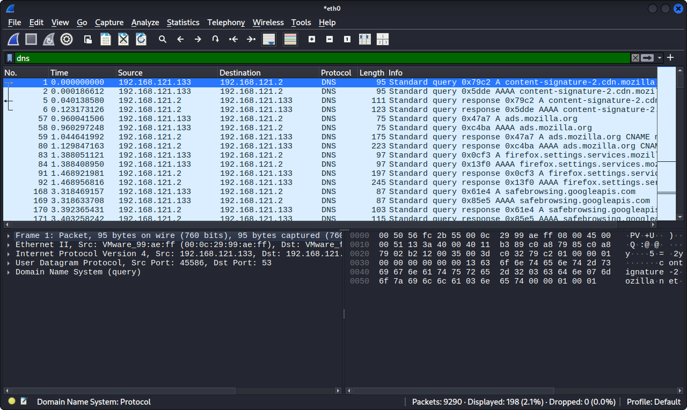
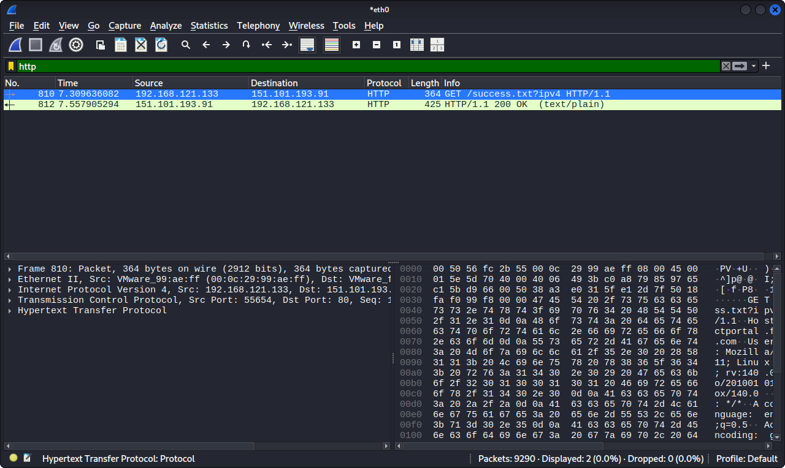

# Wireshark Analysis - rk_eth0P5YOW3.pcapng

## Objective
Analyze captured traffic for suspicious activity.

## Tools Used
Wireshark on Kali Linux

## Findings
- Protocol: TCP, DNS, HTTP
- Investigation steps: Filtered by ip.addr, followed TCP stream
- IoCs Found: Malware download attempt detected

## Evidence - My Screenshots

## MITRE ATT&CK
- T1040 - Network Sniffing
- T1071 - Application Layer Protocol
